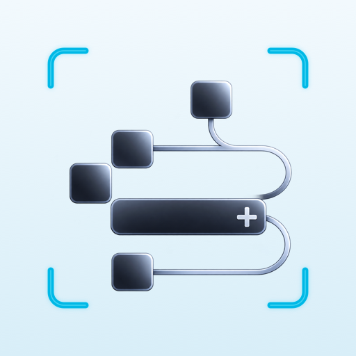
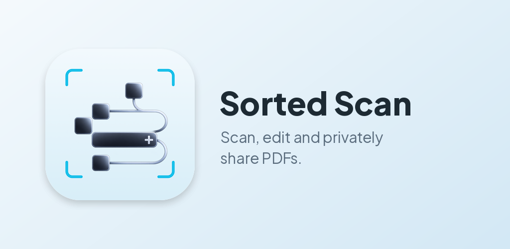
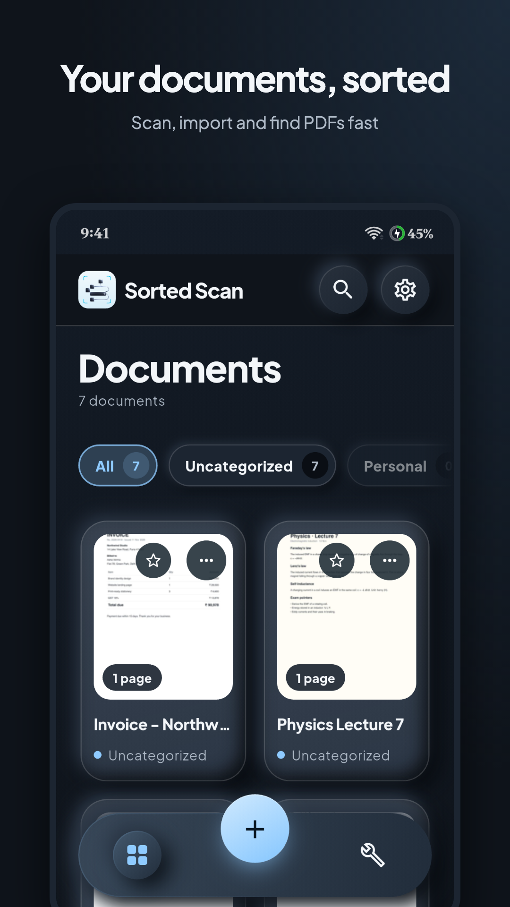
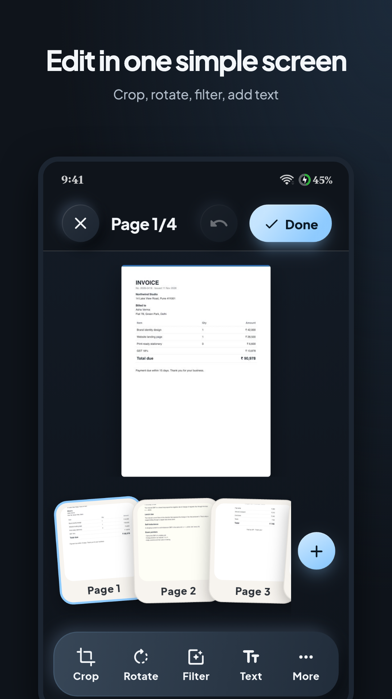
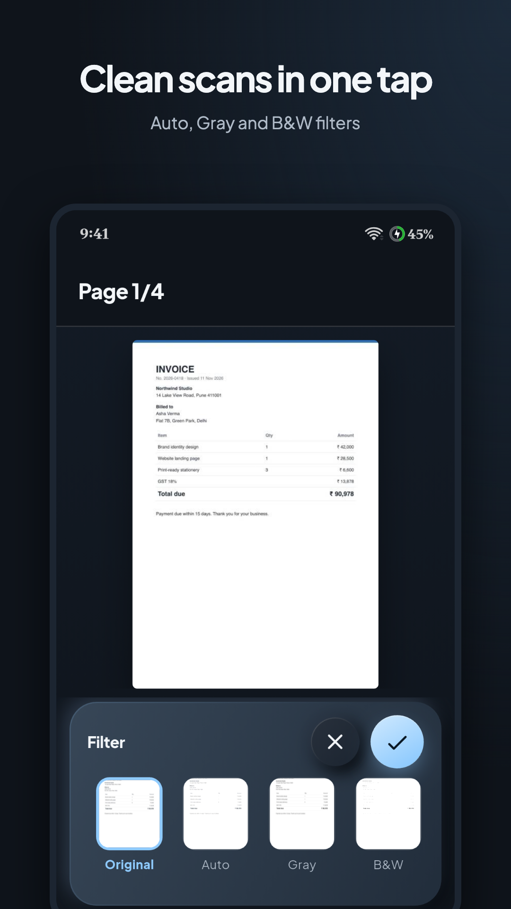
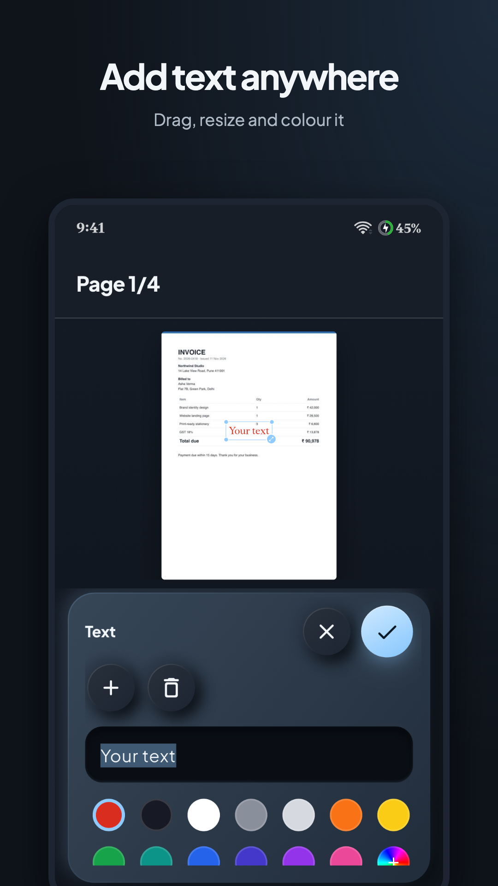
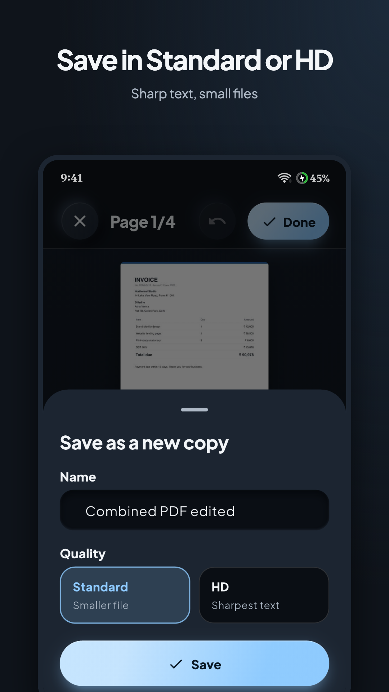
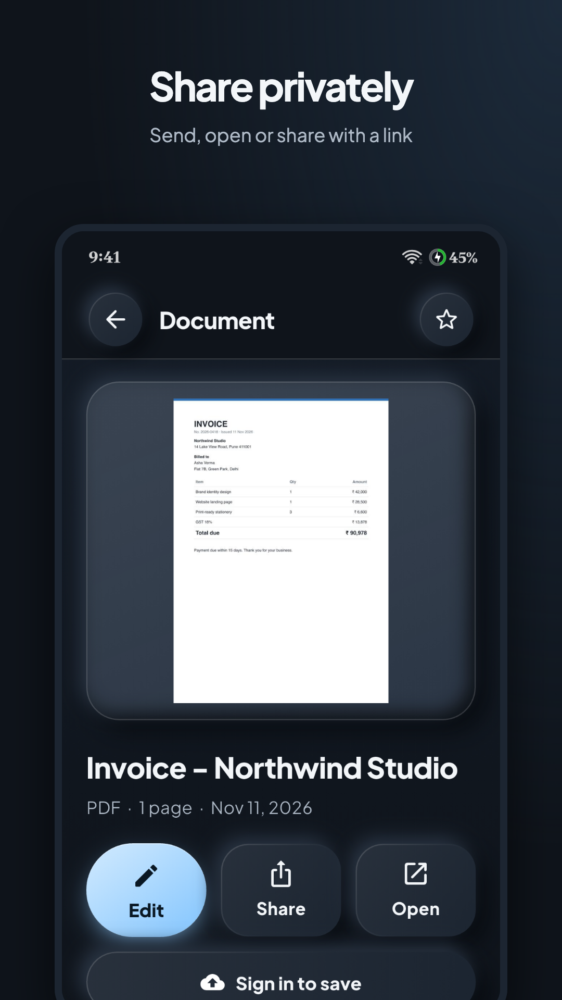
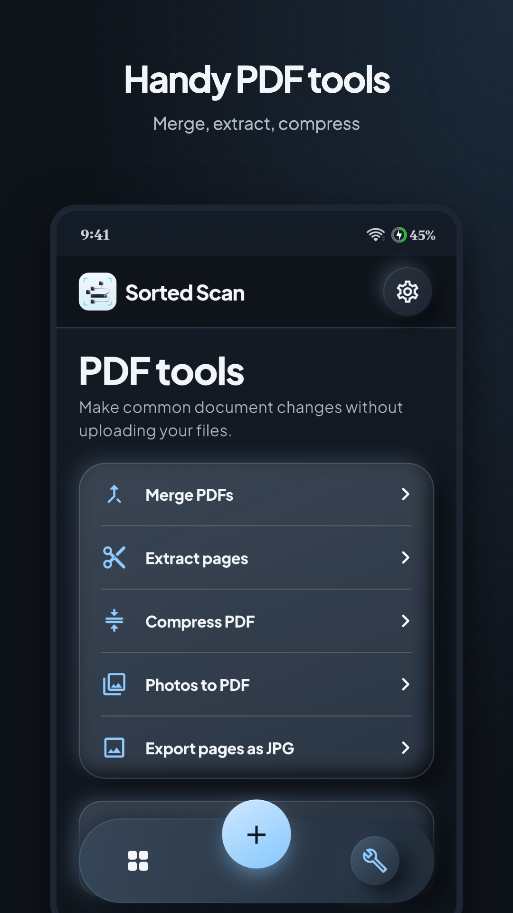

  

<h1 align="center">Sorted Scan</h1>

<b>Scan, edit, and privately share PDFs.</b> 
An Android document scanner and PDF workspace that turns paper into clean, organised PDFs in a few taps, and keeps them private.

  <a href="https://sorted-tab.in">Website</a> ·
  <a href="https://github.com/AaKaShhhhhhhhh/sorted-showcase">Sorted (browser)</a> ·
  <a href="https://github.com/AaKaShhhhhhhhh/sorted-mobile-showcase">Sorted Mobile</a>

  

> This is a public showcase of a product I designed and built. The source code is private; this repository holds screenshots and a product overview.

---

## The idea

Bills, IDs, receipts, certificates, class notes: paperwork you need on your phone today and on your laptop tomorrow. Most scanners make you choose between convenience and privacy. Sorted Scan aims for both: scan to a saved PDF fast, find it anywhere, and keep it yours.

## What it does

**Capture**
- Scan paper with automatic edge detection, import an existing PDF, or turn photos into a PDF.
- Auto clean-up makes text crisp; compare against the original and switch any time.

**Organise**
- Name and categorise each document (Personal, Identity, and more).
- Search, filter, favourite, rename, share, or open documents from one library.
- Works fully on the phone, no account needed.

**Edit**
- Reorder, rotate, crop, and remove pages.
- Auto, Original, Grayscale, and Black & White looks, with brightness and contrast.
- Add text and freehand markup; undo, and press and hold to see the original.
- Edits save as a new copy, so the original is never lost.

**PDF tools**
- Merge PDFs, extract pages, compress, turn photos into a PDF, and export pages as images.
- Save in Standard (small files) or HD (sharpest text).

**Sorted account (optional)**
- Sign in with the same account as Sorted to open your scans on [sorted-tab.in](https://sorted-tab.in) from a laptop.
- PDFs saved to Sorted are end-to-end encrypted: only your own devices can read them.
- Share through private links you can revoke.

---

## Screenshots

<table>
  <tr>
    <td></td>
    <td></td>
    <td></td>
    <td></td>
  </tr>
  <tr>
    <td align="center">Your documents, sorted</td>
    <td align="center">Edit in one screen</td>
    <td align="center">Clean scans in one tap</td>
    <td align="center">Add text anywhere</td>
  </tr>
  <tr>
    <td></td>
    <td></td>
    <td></td>
    <td></td>
  </tr>
  <tr>
    <td align="center">Standard or HD</td>
    <td align="center">Share privately</td>
    <td align="center">Handy PDF tools</td>
    <td></td>
  </tr>
</table>

---

## The Sorted family

| Product | What it is |
|---|---|
| [**Sorted**](https://github.com/AaKaShhhhhhhhh/sorted-showcase) | Browser extension + web dashboard for tab workspaces |
| [**Sorted Mobile**](https://github.com/AaKaShhhhhhhhh/sorted-mobile-showcase) | Android companion: saved links, reminders, and planned phone time |
| **Sorted Scan** (this page) | Android document scanner and PDF editor on the same account |

## My role

Co-founder of Sorted. I built Sorted Scan entirely myself, from product and visual design to the Android app, end-to-end encrypted sync with the Sorted website, and the Play Store assets. It is currently in testing on Google Play.

---

© Sorted. Screenshots are shared for portfolio purposes. All rights reserved.

